# 📘 Documentación Técnica del Proyecto Final

**Proyecto:** Generación Musical Polifónica mediante Redes Neuronales Recurrentes (LSTM) y Visualizador Interactivo MIDI Studio  
**Materia:** Diseño, Visualización y Comprensión de Deep Neural Networks  
**Autor:** Roberto Alejandro Chagra Martinez  
**Código:** 208447128  

---

## 1. Resumen Ejecutivo y Arquitectura del Sistema

El presente proyecto aborda el procesamiento, modelado generativo profundo y visualización interactiva de música simbólica en formato **MIDI (Musical Instrument Digital Interface)**. A diferencia del audio digital crudo (formas de onda muestreadas a miles de hercios), un archivo MIDI describe eventos musicales discretos (altura tonal o *pitch*, velocidad de pulsación o *velocity*, tiempos de encendido/apagado e instrumentos asignados).

El sistema se divide en dos subsistemas principales:
1. **Subsistema de Ingeniería de Datos y Deep Learning (`Parte 1`):** Construye un pipeline modular de 6 fases que audita, limpia, cuantiza y transforma archivos `.mid` del videojuego *Super Mario 3D World* en tensores binarios de *Piano Roll*, entrena una red neuronal recurrente **LSTM multicapa (`GeneradorMIDI_LSTM`)** en PyTorch para predecir la evolución temporal polifónica, y sintetiza nuevas composiciones de manera autoregresiva.
2. **Subsistema de Síntesis Acústica y Visualización Interactiva (`Parte 2 - MIDI Studio`):** Proporciona una estación de reproducción interactiva basada en `ipywidgets`, síntesis por tabla de ondas con `FluidSynth` (`assets/FluidR3_GM.sf2`) y un motor gráfico en `HTML5 Canvas` + `Web Audio API` que renderiza el *Piano Roll* en tiempo real y permite reorquestar cualquier obra con los 128 timbres del estándar *General MIDI*.

```mermaid
flowchart LR
    subgraph Parte1["Parte 1: Pipeline de Datos y Generación Musical con LSTM"]
        A["Dataset MIDI<br/>(Super Mario 3D World - 21 archivos)"] --> B["Fase 1: Auditoría de Calidad<br/>(Duración >= 2.0s y corrupción)"]
        B --> C["Fase 2: Limpieza Estructural<br/>(Eliminación de percusión Canal 10)"]
        C --> D["Fase 3: Cuantización Temporal<br/>(Rejilla discreta fs=5 / fs=10)"]
        D --> E["Fase 4: Extracción de Piano Roll<br/>(Matriz Binaria T x 128 float32)"]
        E --> F["Fase 5 y 6: Ventanas Deslizantes<br/>(11,251 secuencias de 50 x 128)"]
        F --> G["Entrenamiento GeneradorMIDI_LSTM<br/>(2 capas LSTM 256 + Linear 128)"]
        G --> H["Generación Autoregresiva<br/>(600 pasos -> results/mi_primera_composicion_ia.mid)"]
    end

    subgraph Parte2["Parte 2: Reproductor y Visualizador MIDI Studio"]
        H -.-> I["Archivos .mid<br/>(Originales o Generados por IA)"]
        I --> J["Controlador Python (ipywidgets)<br/>Reasignación de 128 Instrumentos GM"]
        J --> K["Síntesis Acústica FluidSynth<br/>(assets/FluidR3_GM.sf2 -> WAV 16kHz Mono PCM_16)"]
        K --> L["Reproductor Web Embebido (iframe)<br/>Web Audio API + Canvas Piano Roll 60 FPS"]
    end
```

---

## 2. Parte 1: Ingeniería de Datos MIDI y Modelado Profundo con LSTM

### 2.1 Origen y Selección del Conjunto de Datos
Se utilizó la librería `kagglehub` para descargar el repositorio `hansespinosa2/nin-video-game-midis`. Con el objetivo de mantener coherencia estilística, rítmica y armónica durante el entrenamiento de la red neuronal, se acotó el dominio a la banda sonora de **Super Mario 3D World** (`Nintendo/WiiU/SuperMario3DWorld`), compuesta por **21 archivos MIDI** polifónicos.

### 2.2 Pipeline de Preprocesamiento en 6 Fases

#### Fase 1: Verificación de Calidad y Duración (`fase1_verificar_calidad`)
Los repositorios masivos de archivos MIDI suelen incluir encabezados truncados, marcas de tiempo negativas o fragmentos de efectos de sonido extremadamente breves.
- Se encapsula la lectura con `pretty_midi.PrettyMIDI(ruta)` dentro de un bloque `try-except`.
- Se calcula el tiempo real de reproducción mediante `midi.get_end_time()`. Todo archivo con duración menor a `duracion_minima = 2.0` segundos o con errores estructurales se descarta automáticamente retornando `None`.

#### Fase 2: Limpieza de Estructura e Instrumentación (`fase2_limpiar_estructura`)
En el estándar General MIDI, el canal 10 está reservado para percusión (`instrumento.is_drum == True`). En dicho canal, el atributo `pitch` no representa una nota en la escala cromática, sino un instrumento percusivo distinto (bombo, caja, platillo).
- Si se mezclaran notas de percusión con pistas melódicas en el *Piano Roll*, el modelo interpretaría erróneamente golpes rítmicos como intervalos armónicos. Por ello, se filtran todas las pistas con `not instrumento.is_drum`.

#### Fase 3: Cuantización Temporal (`fase3_limpiar_contenido_musical`)
Las secuencias MIDI contienen tiempos de inicio (`nota.start`) y fin (`nota.end`) en punto flotante continuo. Para discretizar el eje temporal sin perder la estructura rítmica:
$$t_{\text{cuantizado}} = \frac{\text{round}(t \cdot f_s)}{f_s}$$
donde $f_s$ (`pasos_por_segundo`) define la resolución temporal. Además, para evitar que notas muy cortas colapsen a una duración nula tras el redondeo, se impone la condición de frontera:
$$\text{Si } t_{\text{end}} \le t_{\text{start}} \implies t_{\text{end}} = t_{\text{start}} + \frac{1}{f_s}$$

#### Fase 4: Representación Matemática en Piano Roll Binario (`fase4_extraer_matriz`)
Mediante `midi.get_piano_roll(fs=fs)`, el objeto simbólico se proyecta en una matriz bidimensional de dimensiones $(128, T)$, donde $128$ corresponde al rango completo de tonos MIDI ($0$ a $127$) y $T$ al número total de pasos temporales discretizados.
1. **Transposición:** Se aplica `.T` para obtener la forma $(T, 128)$, priorizando la dimensión temporal como eje de secuencia.
2. **Binarización estricta:** Los valores de velocidad ($0\text{–}127$) se transforman mediante `(tensor_temporal > 0).astype(np.float32)` en estados binarios puros $\{0.0, 1.0\}$. Esto simplifica el espacio de salida y garantiza compatibilidad matemática con funciones de pérdida de entropía cruzada binaria.

#### Fase 5: Segmentación por Ventanas Deslizantes (`fase5_generar_secuencias`)
Dado un tensor de canción $\mathbf{M} \in \{0, 1\}^{T \times 128}$ y una longitud de secuencia $L = 50$, se desliza una ventana con paso unitario ($s = 1$) desde $i = 0$ hasta $T - L - 1$:
$$\mathbf{X}_i = \mathbf{M}[i : i + L, :] \in \mathbb{R}^{L \times 128}$$
$$\mathbf{Y}_i = \mathbf{M}[i + 1 : i + L + 1, :] \in \mathbb{R}^{L \times 128}$$
De esta manera, para cada instante dentro de la ventana $\mathbf{X}_i$, el tensor objetivo $\mathbf{Y}_i$ contiene exactamente la configuración de notas activas en el instante inmediatamente posterior ($t + 1$).

#### Fase 6: Integración con `Dataset` y `DataLoader` de PyTorch (`DatasetDirectorioMIDI`)
Al procesar los 21 archivos de *Super Mario 3D World* con $f_s = 5$ y $L = 50$ (equivalente a ventanas de 10 segundos de contexto musical), el pipeline generó **11,251 pares de secuencias** $(\mathbf{X}, \mathbf{Y})$. El `DataLoader` las entrega en lotes (*mini-batches*) barajados de tamaño $B = 16$, produciendo tensores de entrada con dimensiones:
$$\text{Shape}(\mathbf{X}_{\text{batch}}) = [16, 50, 128]$$

---

### 2.3 Arquitectura de la Red Neuronal `GeneradorMIDI_LSTM`

Para modelar la dependencia temporal polifónica se diseñó la clase `GeneradorMIDI_LSTM(nn.Module)`, estructurada en dos bloques:

| Capa | Tipo en PyTorch | Dimensiones de Entrada | Dimensiones de Salida | Hiperparámetros Clave |
| :--- | :--- | :--- | :--- | :--- |
| **1. Bloque Recurrente** | `nn.LSTM` | `[Batch, 50, 128]` | `[Batch, 50, 256]` | `input_size=128`, `hidden_size=256`, `num_layers=2`, `batch_first=True`, `dropout=0.2` |
| **2. Proyección Densa** | `nn.Linear` | `[Batch, 50, 256]` | `[Batch, 50, 128]` | `in_features=256`, `out_features=128`, `bias=True` |

#### Justificación Arquitectónica
- **Capacidad de Memoria (LSTM de 2 capas con 256 unidades ocultas):** La primera capa LSTM captura transiciones locales (notas de paso, arpegios rápidos y duraciones de notas individuales), mientras que la segunda capa abstrae patrones de nivel superior (progresiones de acordes y frases rítmicas a lo largo de los 50 pasos).
- **Regularización (`dropout=0.2`):** Aplica apagado aleatorio del 20% de las conexiones entre la primera y la segunda capa LSTM durante el entrenamiento, evitando que la red memorice textualmente una sola canción y favoreciendo la generalización.
- **Salida de Logits Directos (sin activación en `forward`):** La capa `nn.Linear(256, 128)` entrega puntuaciones reales sin acotar (*logits*) para cada una de las 128 notas en cada paso temporal.

---

### 2.4 Configuración del Entrenamiento y Convergencia

1. **Función de Pérdida (`nn.BCEWithLogitsLoss`):**
   A diferencia de la generación de texto (donde solo un token es válido por paso y se usa `CrossEntropyLoss` con *Softmax*), en música polifónica **pueden sonar varias notas simultáneamente** (acordes) o **ninguna** (silencio). Por tanto, cada paso temporal constituye un problema de **clasificación binaria multietiqueta con 128 salidas independientes**. `BCEWithLogitsLoss` aplica internamente la función sigmoide $\sigma(z)$ junto con la entropía cruzada binaria aprovechando el *log-sum-exp trick* para máxima estabilidad numérica:
   $$\mathcal{L}(\hat{\mathbf{Y}}, \mathbf{Y}) = -\frac{1}{N} \sum \left[ Y \cdot \log(\sigma(\hat{Y})) + (1 - Y) \cdot \log(1 - \sigma(\hat{Y})) \right]$$
2. **Optimizador (`optim.Adam`):** Configurado con tasa de aprendizaje $\eta = 0.001$.
3. **Recorte de Gradientes (`clip_grad_norm_`):** En cada iteración, antes de ejecutar `optimizador.step()`, se limita la norma L2 de los gradientes a `max_norm = 1.0`. Esto impide el fenómeno de explosión de gradientes característico de la retropropagación a través del tiempo (*BPTT*).
4. **Curva de Convergencia (35 Épocas):**
   - **Época 1 / 35:** Pérdida promedio = `0.0917`
   - **Época 10 / 35:** Pérdida promedio = `0.0177`
   - **Época 20 / 35:** Pérdida promedio = `0.0040`
   - **Época 30 / 35:** Pérdida promedio = `0.0026`

---

### 2.5 Inferencia Autoregresiva y Reconstrucción Simbólica (`tensor_a_midi`)

1. **Generación Autoregresiva (`generar_musica`):**
   - Se coloca el modelo en modo de evaluación (`modelo.eval()`) y se desactiva el cálculo de gradientes (`with torch.no_grad():`).
   - A partir de una semilla inicial $\mathbf{S}_0 \in \mathbb{R}^{1 \times 50 \times 128}$ extraída del dataset, se ejecuta el modelo y se toma exclusivamente el vector de logits del último instante temporal: $\hat{\mathbf{z}}_t = \text{modelo}(\mathbf{S}_{t-1})[:, -1, :] \in \mathbb{R}^{1 \times 128}$.
   - Se calculan las probabilidades $\mathbf{p}_t = \sigma(\hat{\mathbf{z}}_t)$ y se binarizan mediante un umbral de activación $\tau = 0.1$:
     $$\mathbf{a}_t = \mathbb{I}(\mathbf{p}_t > \tau) \in \{0.0, 1.0\}^{1 \times 128}$$
   - El vector $\mathbf{a}_t$ se redimensiona a `[1, 1, 128]` con `.unsqueeze(1)` y se concatena al final de la ventana descartando el paso más antiguo (`secuencia_actual[:, 1:, :]`). Tras `pasos_a_generar = 600` iteraciones, se obtiene una matriz generada de $(600, 128)$.
2. **Algoritmo de Detección de Bordes (`tensor_a_midi`):**
   - Para convertir la matriz $(600, 128)$ en eventos MIDI discretos, se mantiene un diccionario `notas_activas = {}` que registra qué tonos están encendidos y en qué segundo iniciaron (`tiempo_idx * (1.0 / fs)`).
   - **Flanco de subida (`0 -> 1`):** Si `esta_sonando_ahora and not estaba_sonando_antes`, se registra `notas_activas[tono] = tiempo_actual_segundos`.
   - **Flanco de bajada (`1 -> 0`):** Si `not esta_sonando_ahora and estaba_sonando_antes`, se extrae el tiempo de inicio con `notas_activas.pop(tono)` y se instancia un objeto `pretty_midi.Note(velocity=90, pitch=tono, start=tiempo_inicio, end=tiempo_actual_segundos)`.
   - Finalmente, se exporta el archivo `results/mi_primera_composicion_ia.mid` y se sintetiza a `.wav` con `FluidSynth` para su audición directa.

---

## 3. Parte 2: Arquitectura del Reproductor Interactivo MIDI Studio

### 3.1 Diseño Híbrido Python (Backend) + Web Audio / Canvas (Frontend)
En entornos de notebooks interactivos (Jupyter / Google Colab), intentar actualizar una gráfica de `matplotlib` desde Python decenas de veces por segundo mientras suena un audio produce una severa desincronización debido a la latencia de red/IPC entre el kernel de Python y el navegador.

Para resolver este problema de ingeniería, **MIDI Studio** implementa una arquitectura desacoplada en dos niveles:
1. **Nivel de Procesamiento y Síntesis en Python (`cargar`):**
   - Lee el archivo `.mid` con `pretty_midi.PrettyMIDI`.
   - Si la casilla *"Conservar instrumentos originales"* (`original.value`) está desmarcada, itera sobre todas las pistas no percusivas (`not pista.is_drum`) y sobrescribe su atributo `pista.program` con el código General MIDI (`0–127`) elegido en el `Dropdown` `inst_select`.
   - Extrae y ordena cronológicamente hasta `35,000` notas dentro del registro central (`36 <= n.pitch <= 96`), empaquetando cada nota como una tupla ligera `(round(start, 3), round(end, 3), pitch, velocity)`.
   - Escribe el MIDI modificado en un directorio temporal (`tempfile.TemporaryDirectory`) e invoca `fluidsynth -ni -F song.wav -r 16000 -g 0.35` junto con el banco `assets/FluidR3_GM.sf2`.
   - Utiliza `soundfile` (`sf.read` / `sf.write`) para promediar los canales estéreo en una señal **mono** codificada en `PCM_16`, reduciendo drásticamente el tamaño del binario `.wav` y verificando que no supere los `19 MB`.
2. **Nivel de Renderizado Gráfico y Sonoro en Tiempo Real (`player_page`):**
   - Empaqueta el audio `.wav` en Base64 y la lista de notas en JSON dentro de un documento HTML5 autocontenido inyectado en un `<iframe srcdoc="...">`.
   - **Sincronización por Reloj de Hardware (`AudioContext`):** El motor JavaScript decodifica el audio con `ctx.decodeAudioData()` y calcula la posición exacta de reproducción en cada instante mediante:
     $$\text{pos} = \min(\text{duration}, \text{offset} + \text{ctx.currentTime} - \text{started})$$
   - **Renderizado a 60 FPS en `<canvas>` (`draw`):** Utilizando `requestAnimationFrame(draw)` y escalado para pantallas de alta densidad (`window.devicePixelRatio`), dibuja una ventana temporal deslizante de **12 segundos** (`[pos - 2, pos + 10]`). Cada nota se proyecta en coordenadas $(x, y, w, h)$ proporcionales a su inicio, duración y altura tonal (`(96 - p) * h / 60`), diferenciando con color cian brillante (`#55c5ee`) las notas con alta intensidad (`velocity > 90`) y azul (`#6998ff`) las notas suaves, sobre una línea vertical celeste (`#94f9f0`) que marca el instante exacto de audición.
